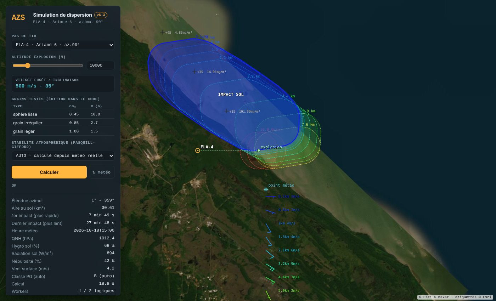

<!--
  Name     : README.md
  Purpose  : Overview of the ballistic and gas dispersion simulation
  Author   : Eric Perret
  Date     : 2026-10-27
  Version  : 6.3
-->

# Ballistic and gas dispersion simulation

🇫🇷 [Version française : LISEZMOI.md](LISEZMOI.md)

▶️ **[Launch the simulation](https://ericperret.github.io/dispersion/dispersion_v62.html)** — 📖 [technical documentation (French)](https://ericperret.github.io/dispersion/dispersion_doc.html)

> One single standalone HTML file — no dependency, no installation, no server.

Dispersion simulation tool for the **Guiana Space Centre** (CSG / Kourou) and other launch pads worldwide.
It computes the fallout path of ballistic debris and the atmospheric dispersion of HCl released by the boosters. User interface in French.

## Files

| File | Description |
|---------|-------------|
| `dispersion_v62.html` | Main application — open it directly in the browser |
| `dispersion_doc.html` | Full technical documentation (architecture, ETS, models), in French |

## Features

| Module | Description |
|--------|-------------|
| **Launch pads** | CSG (ELA-4, ELV, ELS), Florida, Vandenberg, Baikonur, Plesetsk, Vostochny, Wenchang, Jiuquan, Xichang, Tanegashima, Sriharikota |
| **RK45 ballistics** | Adaptive Dormand-Prince integrator · tabulated Cd(Mach) · 7-layer ISA atmosphere · Coriolis force |
| **Gas dispersion** | Pasquill-Gifford model, classes A→F automatic · Turner σ (1970) · AEGL-1/10 HCl threshold = 0.1 mg/m³ |
| **Real-time weather** | Open-Meteo vertical profile (wind, pressure, humidity) — HTTPS GET request, no personal data |
| **Mapping** | Esri World Imagery + Esri labels, no key, no API · fallout zones · AEGL contours · wind barbs |
| **Touch map** | One-finger pan, pinch-to-zoom |
| **Web Workers** | Parallel non-blocking computation |
| **Security** | Strict CSP · watchdog · built-in sanity checks |

## Deployment

Open the link above, or download `dispersion_v62.html` and open it in a modern browser.
No installation, no server, no administrator rights required.

Only two outgoing network calls:

| Destination | Purpose | Data sent |
|-------------|-------|--------------------|
| `api.open-meteo.com` | Vertical wind profile | Launch pad lat/lon only |
| `server.arcgisonline.com` | Esri map tiles (no key) | Tile coordinates (zoom/x/y) |

## Security & IT audit

Source code in clear — not minified, not obfuscated. Readable in any text editor.

- No external library · no CDN · no supply-chain attack surface
- No cookie · no localStorage · no disk write
- All computation data in RAM only

## Physical models

- **Atmosphere** — standard 7-layer ISA
- **Integrator** — adaptive RK45 Dormand-Prince
- **Aerodynamics** — tabulated Cd(Mach)
- **Coriolis** — force included in the state vector
- **Dispersion** — Pasquill-Gifford A→F · Turner coefficients (1970) · 6 classes
- **Operational threshold** — AEGL-1/10 = 0.1 mg/m³ (HCl)

## History

| Version | Change |
|---|---|
| 6.0 | RK45 ballistics, Pasquill-Gifford, open-meteo wind profile, Web Workers, strict CSP |
| 6.1 | Touch map: one-finger pan, pinch-to-zoom |
| 6.2 | Esri base map without key or API, CARTO tiles removed |
| 6.3 | AZS visual identity (app and documentation), link back to www.azs.fr, light / dark documentation |

## Disclaimer

This tool is an **operational decision aid**. It does not replace the official safety systems of the CSG nor the regulatory procedures in force. Results must be interpreted by qualified staff.

---

© Eric Perret 2026 · v6.3 · [www.azs.fr](https://www.azs.fr/)

## License

**Free for non-commercial use** — [CC BY-NC 4.0](https://creativecommons.org/licenses/by-nc/4.0/), with mandatory credit of the source and the author:

> dispersion — Eric PERRET — https://github.com/ericperret/dispersion

Any commercial use is forbidden without the author's written permission, requested by e-mail: **eperret@azs.fr**.
Full terms (French / English): [LICENSE](LICENSE).
